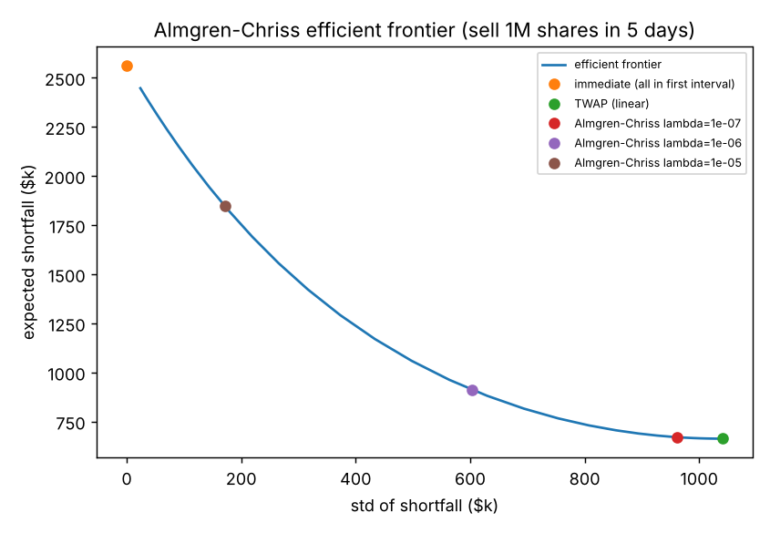
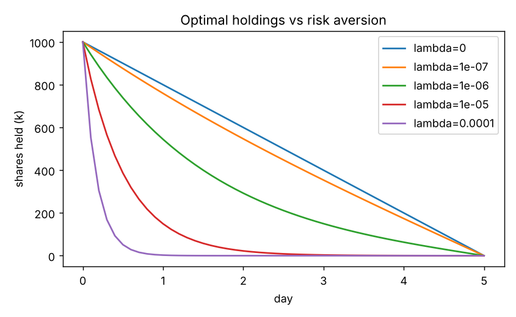

# Optimal Trade Execution (Almgren–Chriss)

Implementation and Monte Carlo study of **Almgren & Chriss (2000), "Optimal execution of portfolio transactions",
*Journal of Risk* 3(2)**: how fast should you sell a large block of stock when trading fast moves the price against you,
but trading slowly leaves you exposed to price risk?

The model gives the closed-form optimal holdings `x(t) = X·sinh(κ(T−t)) / sinh(κT)`, where `κ` grows with risk aversion λ
and volatility and falls with market impact. Every choice of λ gives one point on an **efficient frontier** of expected cost
vs cost risk.

## Contents
| Path | What it does |
|---|---|
| `src/ac/model.py` | Discrete-time model: `κ` from the paper's cosh equation, optimal / TWAP / immediate schedules, analytic `E[IS]` and `Var[IS]` |
| `src/ac/simulate.py` | Monte Carlo implementation shortfall, including trading with a *wrong* impact estimate |
| `scripts/run_experiments.py` | Frontier, strategy comparison, misspecification and grid-refinement experiments |
| `tests/` | 7 tests: boundary conditions, λ→0 gives TWAP, optimality vs random perturbations, Monte Carlo = analytic |

## Results — sell 1,000,000 shares at $50 over 5 days (paper's example parameters)

| Strategy | Expected cost | Std of cost | 95% VaR | Left after day 1 |
|---|---|---|---|---|
| Sell everything at once | $2.56M | $0 | $2.56M | 0% |
| TWAP (linear) | $0.66M | $1.04M | $2.39M | 80% |
| Almgren–Chriss λ = 10⁻⁶ | $0.91M | $0.60M | **$1.91M** | 54% |
| Almgren–Chriss λ = 10⁻⁵ | $1.85M | $0.17M | $2.13M | 18% |

- With λ = 10⁻⁶ the optimal schedule pays **$0.25M more expected cost than TWAP but cuts cost risk by 42%** and has the lowest
  95% VaR of all strategies tested.
- 50,000 simulated paths match the analytic mean and standard deviation (Monte Carlo std within 0.5% for every strategy).
- **Getting impact wrong is costly:** planning with an impact estimate 4× too low raises the risk-adjusted objective by 24.8%;
  4× too high, by 14.3%. Errors of 2× cost 5–6%.
- With a finer trading grid (5 → 100 intervals over the same 5 days) costs converge to the continuous-time values
  (E ≈ $0.96M, std ≈ $0.84M): a coarse grid looks less risky because each interval's trade is treated as instantaneous.

Tables: [`results/summary.md`](results/summary.md)




## Run
```bash
pip install -r requirements.txt
python -m unittest discover -s tests -v
python scripts/run_experiments.py
```
